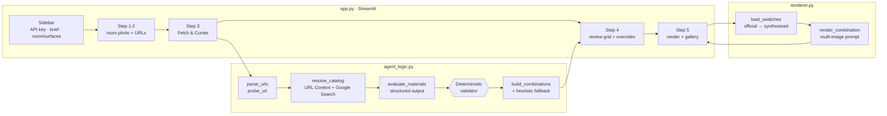

# 🏠 Renovation AI Agent

**An autonomous interior-design copilot that turns real supplier catalogues into photorealistic previews of *your* room.**

Paste one or more laminate portfolio links (Lamitak, Jennings, EDL, Admira…), describe your design rules in plain English, and the agent will:

1. **Resolve** each link into real product codes using Gemini **URL Context + Google Search grounding**
2. **Evaluate** every material against your custom constraints, with a deterministic validator enforcing hard "no-go" rules
3. **Pair** the survivors into structural combinations (base / feature / accent) using interior-design principles
4. **Render** your chosen combination onto your own room photo with **multimodal inpainting**, keeping geometry, perspective and lighting intact

Built with Streamlit and the Google GenAI SDK (`google-genai`). Ready for Streamlit Community Cloud.

---

## The case study

The project started with a real brief: a **Desert Modernism** scheme for a new 5-room BTO flat in Singapore. That meant sun-bleached plaster, limestone and travertine, and terracotta-taupe earth tones, with **zero wood or timber finishes** to follow BaZi elemental guidance.

Two things made this slow in practice:

- **Catalogue curation.** Suppliers publish hundreds of codes. Checking each one against a strict, partly *negative* brief ("no wood, including printed woodgrain") is tedious and easy to get wrong.
- **Visualisation.** Generic AI image generators "reimagine" the room. Doors move, perspective shifts, and the preview no longer matches the real space.

The Renovation AI Agent solves both problems. The brief is not hard-coded, so the same app serves a Japandi client who *requires* light oak and fluting just as well as the desert-modernist who forbids wood.

---

## Architecture



| Module | Responsibility |
|---|---|
| [`app.py`](app.py) | Streamlit UI, session state, caching, secrets handling and user-facing error display. |
| [`agent_logic.py`](agent_logic.py) | URL parsing, grounded catalogue resolution, constraint evaluation, validator, combination engine, error translation and the SSRF-guarded HTTP helper. |
| [`renderer.py`](renderer.py) | Image validation and normalisation, swatch acquisition and synthesis, the inpainting prompt, image-model calls and result parsing. |

---

## How it works

### 1. Portfolio URL ingestion with Gemini grounding

Supplier sites are often JavaScript-rendered, paginated or bot-protected, so a hand-written HTML scraper breaks easily. The agent hands the URL to Gemini with two tools enabled:

```python
tools = [
    types.Tool(url_context=types.UrlContext()),        # read the page itself
    types.Tool(google_search=types.GoogleSearch()),    # fill gaps from the supplier's official listings
]
```

The model is told to return **only real, published codes** and to leave out anything it is unsure of. For each product it returns the code, name, category, finish, colour family, approximate hex colour, a description and the official swatch URL when it can find one.

- **Fallback:** if a model or region doesn't support URL Context, the call retries automatically with Search grounding alone.
- **Probe:** a light `requests` check first records page reachability and the page title, which is passed to the model as a hint. A failed probe is only a warning, because grounding often succeeds anyway.
- **Citations:** grounding citations (search chunks and URL-context retrievals) appear in the **Grounding sources** tab, so you can check every claim.
- **Isolation:** each URL is handled on its own. One bad link becomes a warning instead of stopping the run. Auth and quota errors stop the run straight away, since every later call would fail too.
- **Clean-up:** results are de-duplicated per supplier and code, category aliases are normalised (`travertine → stone`, `woodgrain → wood`), and malformed hex values and URLs are removed.
- **Caching:** results are cached for an hour with `st.cache_data`, keyed by URL and model. Catalogue data is public, so the cache is shared across sessions to save quota.

> Grounded search calls can't be combined with JSON-schema output, so this step parses a fenced JSON block and validates it with Pydantic. The steps after it use full structured output.

### 2. Context-aware constraint engine

All resolved materials (each with a stable `M001`-style id, so codes from different suppliers can't collide) are sent to Gemini together with your brief. The model returns typed JSON (`response_schema`) containing:

- a one-line `style_summary`
- `excluded_categories` (for example "zero wood/timber" gives `["wood"]`)
- `must_haves` (for example `"light oak woodgrain"`, `"vertical fluting"`)
- a per-item `approved` / `score` / `reason` / `detected_attributes`

**Deterministic validator:** model verdicts are never trusted blindly for hard rules. Any item whose category is in `excluded_categories` is rejected in code, and its reason is marked *"Validator override"*. Items the model skipped are left out by default. A model that slips and approves "Natural Oak" for a no-wood client is therefore caught every time.

In the **Material review** tab you can tick or untick any item to override the agent, then rebuild the combinations from your own shortlist.

### 3. Structured pairing logic

Before any image compute is spent, the agent groups approved materials into combinations for three roles: **base**, **feature** and an optional **accent**. Each role maps to a room-specific surface (for example lower cabinets, upper cabinets and tall-unit accent in a kitchen). Pairings follow base/feature hierarchy, value contrast, colour-temperature consistency, texture layering and the 60-30-10 rule. Must-haves have to appear in every combination.

The returned ids are checked: unknown ids, base equal to feature, and duplicate pairs are all dropped. If nothing valid comes back, a **rule-based fallback** pairs calm categories (solid, plaster, concrete) with expressive ones (stone, fluted, textile, and so on) by fit score. You always get a usable result.

### 4. Multimodal inpainting

The renderer sends a single request containing:

```
[prompt] · "IMAGE 1 — BASE ROOM PHOTO" · <room.png>
         · "IMAGE 2 — SWATCH for the lower cabinets" · <swatch_a.png>
         · "IMAGE 3 — SWATCH for the upper cabinets" · <swatch_b.png>
         · (optional accent)
```

The prompt assigns each swatch to a named surface and sets strict preservation rules. Camera position, perspective and vanishing points stay the same. Cabinet count, panel lines and handles are unchanged. Lighting and shadows are kept, and only the assigned surfaces change, mapped at real-world scale with grain running consistently across doors.

Supporting details:

- **Aspect ratio:** the closest supported `ImageConfig.aspect_ratio` is chosen from the base photo, so the output keeps the same framing. If a model rejects it, the call retries without it.
- **Swatches:** official swatch images are downloaded through an SSRF-guarded fetcher. Every redirect hop is re-checked against private, loopback and link-local addresses, with content-type and size limits. Files go into a `tempfile.TemporaryDirectory` that is removed after each render.
- **Swatch fallback:** if there's no usable official image, a text-free swatch is generated from the material's colour profile, with texture by category (stone veining, wood grain, fluting, terrazzo chips). This works better than plain text, because image models follow image references more closely than words.
- **Base photo:** the photo is EXIF-oriented, converted to RGB and capped at 1536 px. The app keeps everything else in memory and writes nothing else to disk, which suits ephemeral cloud containers.
- **Safety blocks:** a safety block or a text-only response is reported as a clear message, never a traceback.

---

## Error handling

Every Gemini and network exception goes through `friendly_api_error()`, which turns it into an `AgentError` with a plain-language message. The raw detail is kept in a collapsible **Technical details** panel.

| Situation | What the user sees |
|---|---|
| Invalid or missing API key | "Gemini rejected the API key…" |
| 429 / quota | "Rate limit or quota reached… wait a minute" |
| Model not enabled (404) | "Pick a different model under Advanced model settings" |
| Bad or unreachable URL | A per-URL warning; the other URLs still run |
| No products resolved | Suggests a more specific collection page |
| Fewer than 2 approved materials | Suggests loosening the brief or adding URLs |
| Image blocked or not returned | A clear retry or adjust message |

---

## Keys, costs and the shared demo key

| Visitor | Steps 1–4 (catalogue lookup, curation, pairing) | Step 5 (image render) |
|---|---|---|
| **Brings their own key** | ✅ on their key | ✅ if their Google project has billing enabled |
| **No key** | ✅ on the owner's shared **demo key**, 3 runs per session | ❌ asked to add their own key |

- **Image models are paid-only.** Gemini image models (`gemini-3.1-flash-image`, `gemini-3.1-flash-lite-image`) have **0 free-tier quota**, so rendering always needs a key from a project with billing enabled.
- **Demo key:** set `GEMINI_DEMO_KEY` in secrets to a free-tier key from a **separate Google project with no billing**. That way keyless visitors can never cause charges.
- **Never for rendering:** the app never sends image requests with the demo key, and enforces this in code, not only in the UI.
- **Fair share:** a per-session cap of `DEMO_RUNS_PER_SESSION` (3) splits the shared free quota fairly between visitors.
- **Privacy:** free-tier requests may be used by Google to improve its products, so the app warns visitors not to upload private photos when using the demo key.

## Run locally

```bash
python -m venv .venv && source .venv/bin/activate
pip install -r requirements.txt
export GEMINI_API_KEY="your-key"        # or paste it into the sidebar
streamlit run app.py
```

Get a key at [Google AI Studio](https://aistudio.google.com/apikey). You can also copy `.streamlit/secrets.toml.example` to `.streamlit/secrets.toml`; it is git-ignored.

## Deploy to Streamlit Community Cloud

1. Push this folder to a GitHub repository.
2. On [share.streamlit.io](https://share.streamlit.io), click **Create app** and point it at `app.py`.
3. Under **Advanced settings → Secrets**, add:
   ```toml
   GEMINI_API_KEY = "your-key"
   ```
4. Deploy. For a public portfolio demo, set **only** `GEMINI_DEMO_KEY` (a free-tier key with no billing) and not `GEMINI_API_KEY`. Visitors can then try curation for free and bring their own key to render.

> Never put a billing-enabled key in public secrets, because every visitor would spend your money. Use a free-tier `GEMINI_DEMO_KEY` from a separate project instead.

## Configuration

| Setting | Where | Default |
|---|---|---|
| Reasoning and grounding model | Sidebar → Advanced | Newest stable `gemini-X.Y-flash-lite` (currently `gemini-3.5-flash-lite`) |
| Image model | Sidebar → Advanced | Newest stable `gemini-X.Y-flash-image` (currently `gemini-3.1-flash-image`) |
| Max products per URL | Sidebar → Advanced | 20 |
| Combinations proposed | Sidebar → Advanced | 4 |
| Room type and surface names | Sidebar | Kitchen: lower / upper / accent |

The model pickers list only the models your key can call (fetched with `client.models.list()`). The default is the **newest stable** model in each family: the highest `gemini-X.Y-flash-lite` for text and the highest `gemini-X.Y-flash-image` for images. Preview, experimental and dated variants are skipped, so new releases are picked up without a code change. If no such model is listed, a curated preference list is used. If listing fails, the pickers become free-text fields.

## Project structure

```
.
├── app.py                         # Streamlit UI
├── agent_logic.py                 # grounding, evaluation, validator, pairing
├── renderer.py                    # swatches + multimodal inpainting
├── requirements.txt
├── .streamlit/
│   ├── config.toml                # warm "desert" theme, upload limit
│   └── secrets.toml.example
└── README.md
```

## Limitations and next steps

- Product data is resolved by AI from public pages. **Check codes with the supplier before ordering.**
- Official swatch URLs aren't always available, in which case the render uses a synthesised swatch based on the material's colour.
- Next steps could include a mask-painting canvas for pixel-exact surface selection, batch rendering of every combination, and exporting a PDF mood board with codes and renders.
